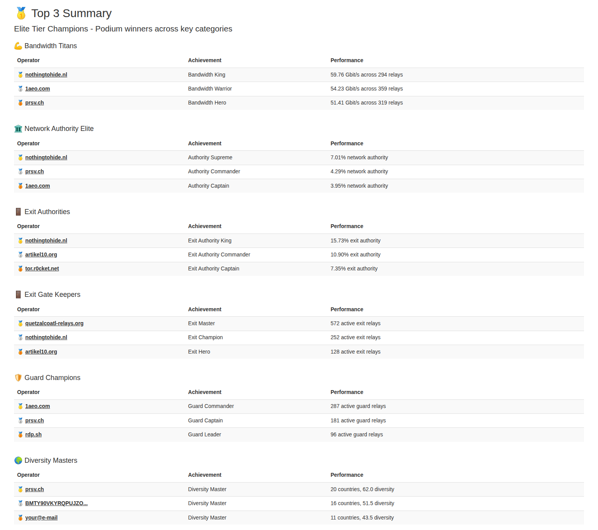
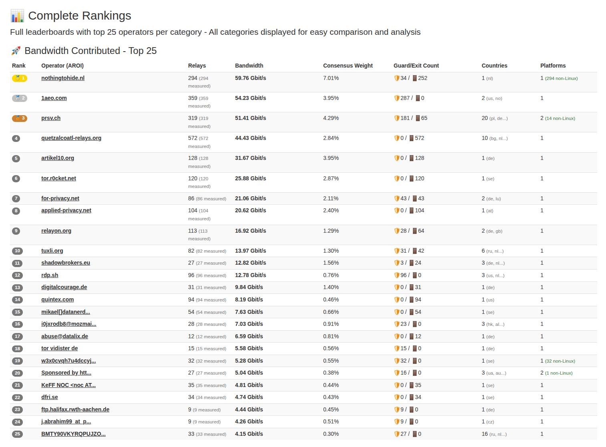
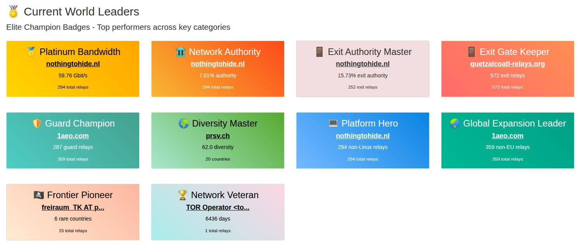
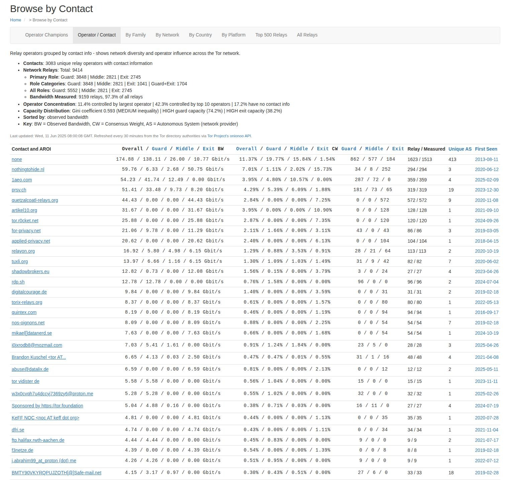
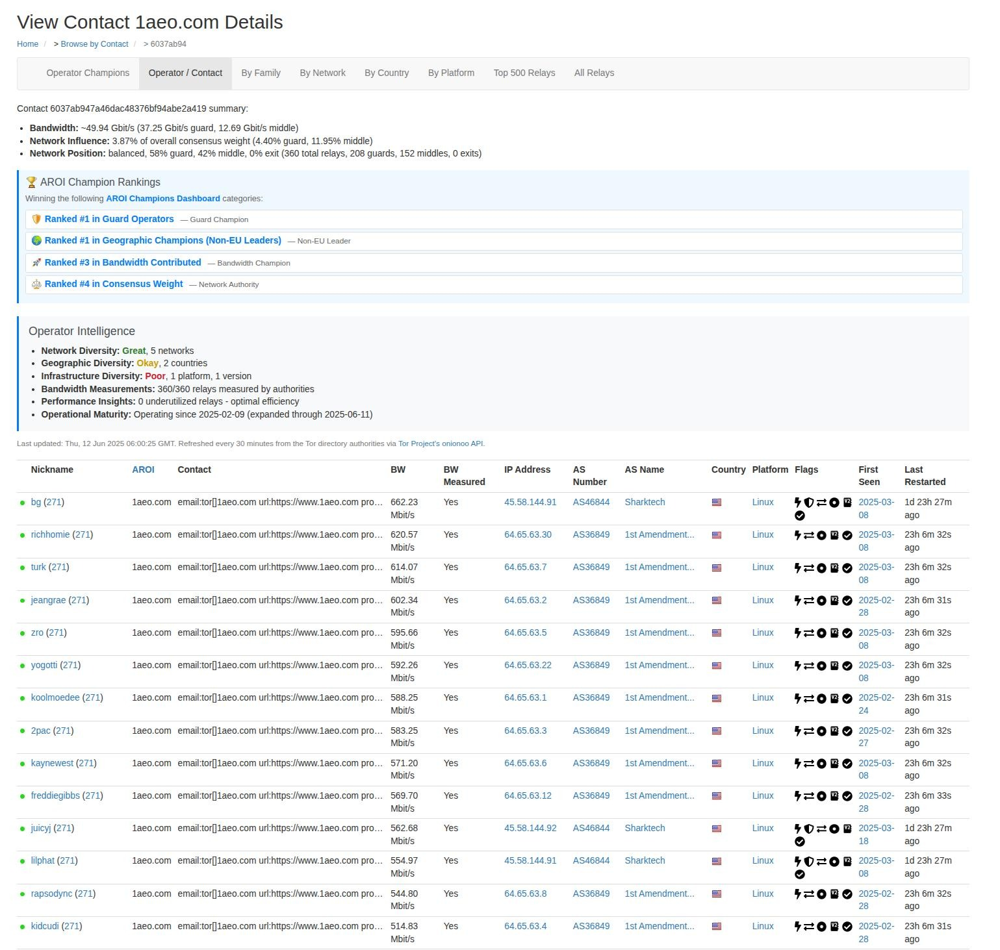

# Allium

[](https://github.com/1aeo/allium/actions)
[](https://www.python.org/downloads/)
[](https://unlicense.org/)

**Advanced Tor Relay Analytics & Metrics Platform** — a security-hardened static site generator that produces a browsable Tor relay analytics site from Onionoo, AROI Validator, Exit DNS Health, CollecTor, and Tor Metrics data.

### What You Get

- **Static site output** in `./www/` (when run from repo root or via `setup.sh`) or `allium/www/` (when run inside `allium/`)
- **Relay + operator analytics** — bandwidth, consensus weight, diversity views, uptime/reliability, network health, network pressure, and Prometheus `metrics`
- **AROI leaderboards** — 21 specialized categories recognizing authenticated relay operators

### Why Allium?

- **Privacy-First** — Generates static HTML requiring no server-side processing or JavaScript dependencies
- **Security-Hardened** — Input sanitization, XSS protection, and dependency scanning built-in
- **Deep Intelligence** — Goes beyond basic metrics with operator leaderboards and a 7-layer analytics engine

*Originally forked from [allium](https://git.jordan.im/allium), this version adds extensive analytics, operator leaderboards, and intelligence features.*



## Quick Start

### One-command setup (recommended)

```bash
curl -sSL https://raw.githubusercontent.com/1aeo/allium/master/setup.sh | bash
```

### Safer install (inspect script first)

```bash
curl -fsSL https://raw.githubusercontent.com/1aeo/allium/master/setup.sh -o setup.sh
less setup.sh
bash setup.sh
```

### Manual installation

```bash
git clone https://github.com/1aeo/allium.git && cd allium
# Debian/Ubuntu: venv support, then the cairo library and chart font for PNG charts (without libcairo2 they are SVG)
sudo apt install python3-venv libcairo2 fonts-dejavu-core

python3 -m venv venv && source venv/bin/activate  # On Windows: venv\Scripts\activate
pip install -r config/requirements.txt
python3 allium/allium.py --progress --no-pressure-history
cd www && python3 -m http.server 8000
# Visit http://localhost:8000
```

### Common Tasks

| Task | Command |
|------|---------|
| Generate site (fast local run) | `python3 allium/allium.py --progress --no-pressure-history` |
| Generate full site (with backfill) | `python3 allium/allium.py --progress` |
| Serve output | `cd www && python3 -m http.server 8000` |
| Custom output dir | `python3 allium/allium.py --out /path/to/site` |
| Minimal memory mode | `python3 allium/allium.py --apis details --progress` |

### Resource Notes

- **Memory**: Plan for **~3GB RAM** available (the uptime dataset alone peaks around ~2GB)
- **Time**: Steady-state generation takes **~2–5 minutes** producing ~21,700 HTML pages; the initial CollecTor pressure-history backfill on an empty cache takes **~90 minutes** (`--no-pressure-history` skips it)
- **Disk**: Output is ~500MB of HTML plus ~3.6GB of PNG charts (hard-linked from `allium/data/cache/charts/` on the build host; ~0.7GB as `--chart-format svg`)

**[Full Quick Start Guide](docs/user-guide/quick-start.md)** — setup instructions, troubleshooting, and deployment options.

## Table of Contents

- [Key Features](#key-features)
- [Usage & Configuration](#usage--configuration)
- [API Data Sources](#api-data-sources)
- [Security & Performance](#security--performance)
- [Requirements](#requirements)
- [Documentation](#documentation)
- [Contributing](#contributing)
- [Screenshots](#screenshots)
- [License](#license)
- [References](#references)

## Key Features

<details>
<summary><strong>Data Processing & History Charts</strong></summary>

- Threaded API fetching across 7 enabled workers under `--apis all` (plus daily CollecTor pressure-history backfill)
- Multiprocessing page generation (configurable via `--workers`, default `max(4, CPU count)`)
- Downtime filtering: excludes relays not seen for >7 days before the Onionoo snapshot (`--filter-downtime`)
- Generates relay, contact, country, AS, family, platform, flag, and `first_seen` pages
- Build-time PNG/SVG history charts (1M/6M/1Y/5Y) with no JavaScript across relay, contact, network, and pressure pages (`allium/data/cache/charts/`), with CSS `:target` period switching and deep links (`#bandwidth-6m`, `#6m`)

</details>

<details>
<summary><strong>AROI Leaderboards (21 Categories)</strong></summary>

Authenticated Relay Operator Identification system ranking verified operators:

- **Capacity**: Bandwidth Contributed, Consensus Weight Leaders, Total Data Transferred Champions (5yr)
- **Roles**: Exit/Guard Authority Champions, Exit/Guard Operators
- **Reliability (>25 relays)**: Reliability Masters (6mo), Legacy Titans (5yr), Bandwidth Served Masters (6mo), Bandwidth Served Legends (5yr)
- **Diversity**: Diversity All-Rounders (0–100 Diversity Index), Non-Linux Powerhouses, OS Polyglots (2+ OSes incl. Linux), Global Powerhouses, Jurisdiction Globetrotters, Frontier Builders
- **Infrastructure**: Network Veterans, IPv4/IPv6 Address Leaders, AROI Validation Champions (CIISS v2 + v3 dual-spec with migration tier badges)

</details>

<details>
<summary><strong>Network Health, Pressure, Diagnostics & Metrics</strong></summary>

- **Network Health (`network-health.html`)**: 12 metric cards (Relay Counts, Bandwidth Capacity Availability, Relay Uptime, Operator Participation, Geographic Participation, Provider Participation, Bandwidth Utilization, Version Compliance, Unique Operating Systems, Happy Families Key Migration, Exit Policies, Exit DNS Health) plus Network History charts
- **Network Pressure (`network-pressure.html`)**: Daily series for overload share, Guard/HSDir counts, and directory bytes served against frozen baseline ranges
- **API Diagnostics (`misc/diagnostics.html`)**: Cache age, freshness status, AROI diagnostics, and site-section dependency matrix
- **Prometheus Metrics (`metrics`)**: Prometheus text exposition v2 for exit DNS health, upstream resolvers, AROI states, and source health
- **Directory Authorities (`misc/authorities.html`)**: Authority uptime, Z-score outliers, latency probes, and consensus participation

</details>

<details>
<summary><strong>Intelligence Engine (7 Layers) & Reliability</strong></summary>

- 7-layer analysis pre-computing Basic Relationships, Concentration Patterns, Performance Correlation, Infrastructure Dependency, Geographic Clustering, Capacity Distribution, and Contact Intelligence
- Multi-period uptime tracking (1M/6M/1Y/5Y) with `Exit > Guard > Fast > Running` priority, network percentiles, and ≥2σ outlier detection

</details>

## Usage & Configuration

```bash
# Generate with progress tracking (steady-state or incremental update)
python3 allium/allium.py --progress

# Fast local build skipping CollecTor pressure-history backfill
python3 allium/allium.py --out www_baseline --apis all --progress --no-pressure-history

# Custom output directory with production base URL and bytes units
python3 allium/allium.py --out /var/www/tor-metrics --base-url https://metrics.example.com --display-bandwidth-units bytes

# Minimal memory mode (~400MB instead of ~2.4GB)
python3 allium/allium.py --apis details --progress
```

See the **[Configuration Guide](docs/user-guide/configuration.md)** for all 20 CLI flags and environment variables (or run `python3 allium/allium.py --help`).

## API Data Sources

Allium fetches data in parallel threads (`allium/lib/workers.py`), caches responses under `allium/data/cache/`, and gracefully falls back to cache or disables non-critical features on transient failures:

- **Onionoo Details, Uptime & Bandwidth** (`onionoo.torproject.org`) — core relay state, multi-period uptime, and read/write bandwidth histories
- **AROI Validator** (`aroivalidator.1aeo.com/latest.json`) — CIISS v2 + v3 operator cryptographic proofs
- **Exit DNS Health** (`exitdnshealth.1aeo.com/latest.json`) — exit DNS resolution tests and upstream resolver shares
- **CollecTor Consensus & Server Descriptors** (`collector.torproject.org`) — authority votes, flag thresholds, and Happy Families `family-cert` Ed25519 keys
- **CollecTor Pressure History & Tor Metrics** (`allium/lib/pressure_history.py`) — post-coordinator daily backfill of overload descriptors, `relayflags.csv`, and `dirbytes.csv`

**`first_seen` correction**: To work around an upstream Onionoo `/details` reset bug, `allium/lib/first_seen_correction.py` cross-checks each relay's `first_seen` against earlier non-null `/uptime` observations before building the relay set. See **[API Integration](docs/reference/api-integration.md)** for full details, cache lifetimes, and failure handling.

## Security & Performance

- **Global XSS protection** via Jinja2 autoescape
- **Input sanitization** for all external data sources
- **Static generation** eliminating server-side vulnerabilities
- **No JavaScript dependencies** for maximum security
- **Real-time memory usage tracking** during generation
- **Scalable architecture** supporting large relay counts

## Requirements

### Production

- **Python 3.8+**
- **Jinja2 ≥2.11.2**

### PNG charts

PNG is the default chart format; `--chart-format svg` and `--no-charts` need none of this. It needs
**cairocffi ≥1.2.0** and **numpy ≥1.17** from `config/requirements.txt` (and optionally **zlib-ng**, ~4x faster
deflate), plus the cairo library, which pip cannot install. Without them allium writes SVG charts and prints the
commands that install them for the Python it runs on. The DejaVu Sans font, also a system package, keeps the chart
font: without it allium warns, and the PNG text falls back to another font.

```bash
# A virtualenv, after pip install -r config/requirements.txt
sudo apt install libcairo2 fonts-dejavu-core   # Debian/Ubuntu
sudo dnf install cairo dejavu-sans-fonts       # Fedora

# Debian/Ubuntu's own python3, no virtualenv (on Ubuntu, python3-cairocffi is in universe)
sudo apt install python3-jinja2 python3-cairocffi python3-numpy libcairo2 fonts-dejavu-core
```

### Development (Additional)

- **pytest ≥6.0.0** — Unit testing framework
- **pytest-cov ≥2.10.0** — Coverage reporting
- **pytest-timeout ≥2.0.0** — Test execution timeouts
- **flake8 ≥3.8.0** — Code style checker
- **bandit ≥1.7.0** — Security vulnerability scanner
- **safety ≥1.10.0** — Dependency vulnerability checker
- **djlint ≥1.0.0** — HTML/template linter
- **memory-profiler ≥0.60.0** — Memory usage profiling

## Documentation

Comprehensive documentation in [`docs/`](docs/):

### For Users

- **[Quick Start](docs/user-guide/quick-start.md)** — Installation and first run
- **[Configuration Guide](docs/user-guide/configuration.md)** — All 20 CLI options and automation setup
- **[Deployment Guide](docs/user-guide/deployment.md)** — Web server setup and staged cron publishing
- **[Troubleshooting](docs/user-guide/troubleshooting.md)** — Common issues and solutions

### For Developers & Operators

- **[Architecture Overview](docs/architecture/overview.md)** — System design and data flow
- **[Testing Standards](docs/development/testing.md)** — Test naming and organization
- **[Security Guide](docs/development/security.md)** — Security best practices
- **[Implemented Features](docs/features/implemented/README.md)** — Behavior specs for shipped features
- **[Prometheus Metrics](docs/prometheus/README.md)** — Schema v2 reference and alert rules

### Additional Resources

- **[Documentation Index](docs/README.md)** — Full navigation
- **[Current Capabilities](docs/reference/current-capabilities.md)** — All working features
- **[Output Structure](docs/reference/output-structure.md)** — Generated file tree
- **[API Integration](docs/reference/api-integration.md)** — Data sources and caching
- **[Planned Features](docs/features/planned/README.md)** — Future proposals

## Contributing

Contributions welcome! See [CONTRIBUTING.md](CONTRIBUTING.md) for detailed instructions.

### Developer Setup

Follow [Quick Start](#quick-start), then install dev dependencies:

```bash
pip install -r config/requirements-dev.txt
```

**Run tests**: `pytest` • **Lint**: `flake8 .` • **Security scan**: `bandit -r .`

### Contributing Areas

- Security enhancements and vulnerability reporting
- Analytics improvements and new leaderboard categories
- Geographic intelligence and country classification updates
- Performance optimizations and memory efficiency
- Template improvements and UI enhancements

## Screenshots

### AROI Leaderboard - Top 3 and Top 6 Champions


Main AROI leaderboard showing top operators across categories with expandable views.

### AROI Leaderboard - Top 25 Bandwidth Champions



Detailed ranking of top bandwidth contributors with network impact metrics.

### AROI Leaderboard - Champions Badges



Achievement badge system displaying operator accomplishments.

### Browse by Contact



Contact-based interface for exploring relay operators grouped by contact information.

### Browse by Contact - 1aeo Example



Individual operator profile showing relay family details and geographic distribution.

## License

**UNLICENSE** (public domain)

**Third-Party Assets**: Country flags (GoSquared), Relay flags (The Tor Project)

## References

- [Original allium](https://git.jordan.im/allium) — Fork source
- [Tor Metrics Project](https://metrics.torproject.org/) — Official metrics (inspiration)
- [Onionoo API](https://onionoo.torproject.org/) — Tor relay data source
- [Tor Project](https://www.torproject.org/) — Privacy and anonymity network

---

**allium** — Empowering Tor network analysis with intelligence, security, and performance.
